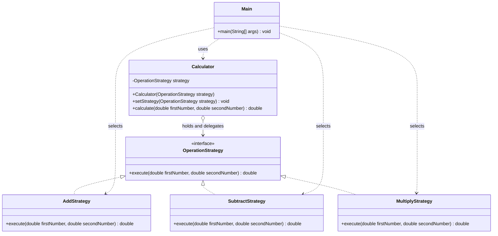

# Assignment 5 Strategy Pattern

## 1 Introduction

This project uses Option B, a calculator. Addition, subtraction, and
multiplication form a family of interchangeable algorithms. Each operation
implements `OperationStrategy`. The `Calculator` stores a strategy and delegates
the calculation to it. `Main` selects the operation and changes it at runtime.

## 2 UML class diagram



## 3 Clean code principles

### Chapter 9 Unit Tests — Single concept per test

Each test checks one behavior: addition, subtraction, multiplication, or runtime
strategy switching. Tests create their own calculator and have one assertion,
so they do not depend on shared state or execution order. This keeps failures
easy to understand. The tests use a small assertion helper with no libraries.

```java
private static void addsTwoNumbers() {
    Calculator calculator = new Calculator(new AddStrategy());
    assertEquals(15.0, calculator.calculate(10, 5)); // Checks only addition.
}
```

### Chapter 10 Classes — Single Responsibility Principle

Each class has one responsibility. Strategies perform arithmetic, `Calculator`
delegates execution, and `Main` configures the strategies and prints the demo.
Changing console output does not require changing an arithmetic class.

```java
// Calculator delegates; it does not select algorithms or print results.
public double calculate(double firstNumber, double secondNumber) {
    return strategy.execute(firstNumber, secondNumber);
}
```

### Chapter 11 Systems — Separate construction from use

`Main` constructs the concrete strategies and supplies them to `Calculator`.
The calculator only uses the supplied interface and does not create its own
arithmetic algorithms. Passing the strategy through the constructor or setter
is a simple form of dependency injection; no framework is needed.

```java
// Main constructs and supplies the concrete algorithm.
Calculator calculator = new Calculator(new AddStrategy());

// Calculator uses the supplied algorithm through the interface.
public double calculate(double firstNumber, double secondNumber) {
    return strategy.execute(firstNumber, secondNumber);
}
```

## 4 Conclusion

The same calculator object can add, subtract, multiply, and switch back to
addition. Its context contains no `if` or `switch` for operation types because
polymorphism selects the implementation of `execute`.

A new operation needs another implementation of `OperationStrategy` and client
code that selects it. Existing algorithms and `Calculator` do not need to change.
This flexibility adds several small classes. For a basic calculator that is
extra structure, but it clearly demonstrates how Strategy separates algorithms
from the object that uses them.

## 5 GitHub repository

Repository link: **Add the GitHub URL after publishing this project.**
